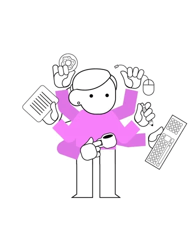

  <!-- Header Animated Banner -->
  

   

  <!-- Animated Greeting & Identity -->
  <h1>
    
    Hey there, I'm Anurag Vishwakarma
    
  </h1>

  <!-- Dynamic Typing SVG Headline -->
  

    

  <!-- Engaging Live Status & Profile View Badges -->
  

    
    &nbsp;
    
    &nbsp;
    
    &nbsp;
    
  

  <!-- Social & Quick Links Badges -->
  
  &nbsp;
  
  &nbsp;
  
  &nbsp;
  
  &nbsp;
  
  &nbsp;
  

 

<!-- Animated Rainbow Neon Line Divider -->

 

<!-- ==================== ABOUT ME SECTION ==================== -->
<table>
  <tr>
    <td width="65%" valign="top">
      <h2> About Me</h2>
      

        Hi! I'm <b>Anurag Vishwakarma</b>, a Software Developer & CS undergraduate passionate about full-stack web engineering, AI-powered applications, and open-source software.
      

      <ul>
        <li>🌱 Building scalable web platforms and generative AI applications.</li>
        <li>💬 Interested in <b>Full-Stack Development, Cloud, and System Architecture</b>.</li>
        <li>📫 Reach out: <a href="mailto:anuraga2005@gmail.com"><b>anuraga2005@gmail.com</b></a></li>
      </ul>
    </td>
    <td width="35%" align="center" valign="middle">
      
    </td>
  </tr>
</table>

 

<!-- Dynamic Animated Daily Dev Quote -->

  

 

<!-- Animated Rainbow Neon Line Divider -->

<!-- ==================== EDUCATION SECTION ==================== -->
## 🎓  Education

- 🏛️ **Madhav Institute of Technology and Science (MITS), Gwalior**  
  *Bachelor of Technology (B.Tech) in Computer Science Engineering* &nbsp;|&nbsp; `2023 – 2027`

 

<!-- Animated Rainbow Neon Line Divider -->

<!-- ==================== EXPERIENCE SECTION ==================== -->
## 💼  Experience

| Role | Organization / Company | Duration |
| :--- | :--- | :---: |
| 🏛️ **Intern** | **IPE Global** *(Gwalior Smart City Development Corporation Ltd.)* | `Jun 2026 – Jul 2026` |
| 💻 **Software Developer Intern** | **Coders Cafe** | `Mar 2024 – Aug 2024` |
| 🌐 **Web Developer Intern** | **Gurukul Dream Foundation** | `Feb 2024 – Mar 2024` |

 

  

 

<!-- Animated Rainbow Neon Line Divider -->

<!-- ==================== FEATURED PROJECTS SECTION ==================== -->
## 🚀  Featured Projects

<table>
  <tr>
    <td width="50%" valign="top">
      <h3>💡 FinAI</h3>
      
<i>AI-Powered Personal Finance Platform</i>

      
<code>React</code> • <code>PostgreSQL</code> • <code>Supabase</code> • <code>OpenAI API</code> • <code>Google OAuth</code>

      
Full-stack AI platform providing intelligent financial insights, automated transaction categorization, and secure OAuth authentication.

    </td>
    <td width="50%" valign="top">
      <h3>🌐 WebGTA</h3>
      
<i>AI-Powered Website Generator</i>

      
<code>PHP</code> • <code>JavaScript</code> • <code>Bootstrap</code> • <code>MySQL</code> • <code>OpenAI API</code>

      
Generative platform that synthesizes complete, multi-page websites from natural language prompts with automated content pipelines.

    </td>
  </tr>
  <tr>
    <td width="50%" valign="top">
      <h3>📚 CSE Notes</h3>
      
<i>Article & Note Management Platform</i>

      
<code>PHP</code> • <code>MySQL</code> • <code>AJAX</code> • <code>JavaScript</code> • <code>Bootstrap</code>

      
Role-based content management platform supporting article publishing, academic note sharing, CRUD operations, and moderation.

    </td>
    <td width="50%" valign="top">
      <h3>💬 JavaSocket-ChatApp</h3>
      
<i>Multithreaded Real-time Chat</i>

      
<code>Java</code> • <code>Socket Programming</code> • <code>TCP/IP</code> • <code>Multithreading</code>

      
Client-server chat application enabling concurrent message broadcasting and real-time bidirectional communication via Java Sockets.

    </td>
  </tr>
</table>

 

  

 

<!-- Animated Rainbow Neon Line Divider -->

<!-- ==================== TECHNICAL SKILLS SECTION ==================== -->
## 🛠️  Technical Arsenal

  <!-- Interactive Skill Icons with animated hover transitions -->
  

 

<table>
  <tr>
    <td width="30%"><b>💻 Languages</b></td>
    <td>
      
      
      
      
      
      
    </td>
  </tr>
  <tr>
    <td width="30%"><b>🎨 Frontend</b></td>
    <td>
      
      
      
      
      
      
    </td>
  </tr>
  <tr>
    <td width="30%"><b>⚙️ Backend & Databases</b></td>
    <td>
      
      
      
      
      
      
      
    </td>
  </tr>
  <tr>
    <td width="30%"><b>☁️ Tools & Platforms</b></td>
    <td>
      
      
      
      
      
      
      
      
    </td>
  </tr>
  <tr>
    <td width="30%"><b>📚 Core Computer Science</b></td>
    <td>
      
      
      
      
      
      
    </td>
  </tr>
</table>

 

<!-- Animated Rainbow Neon Line Divider -->

<!-- ==================== ACHIEVEMENTS SECTION ==================== -->
## 🏆  Honors & Achievements

- 🥇 **Top 10 Project Admin | GirlScript Summer of Code (GSSoC) 2025**  
  *Mentored dozens of contributors, reviewed pull requests, and maintained high repository standards across open-source projects; earned an official Letter of Recommendation.*
- 🥈 **Ranked 36 among Top 50 Project Admins | GSSoC 2024 Extended**  
  *Reviewed, validated, and successfully merged **300+ open-source PRs** across active community repositories.*
- 🐢 **8th Place Finish | Smart India Hackathon (SIH 2025) Internal Round**  
  *Led Team **"Ninja Turtle"** to rank 8th out of **250+ competing engineering teams** at MITS-DU.*
- 🎯 **Top 10 Position | Institute-Level Coding Championship**  
  *Secured Top 10 rank among 150 students in an intense competitive problem-solving contest.*
- 🌟 **Ranked 91 / 27,000+ Contributors | GirlScript Summer of Code 2024**  
  *Recognized among top percentile open-source contributors internationally in GSSoC '24.*
- 🧠 **180+ Data Structures & Algorithms Problems Solved**  
  *Actively sharpening algorithm mastery and problem solving across arrays, dynamic programming, graphs, and trees on [LeetCode](https://leetcode.com/anurag_vish/).*

 

<!-- Animated Rainbow Neon Line Divider -->

<!-- ==================== CONTRIBUTION SNAKE SECTION ==================== -->
## 🐍  Contribution Snake Game

  <picture>
    <source media="(prefers-color-scheme: dark)" srcset="https://raw.githubusercontent.com/platane/platane/output/github-contribution-grid-snake-dark.svg">
    <source media="(prefers-color-scheme: light)" srcset="https://raw.githubusercontent.com/platane/platane/output/github-contribution-grid-snake.svg">
    
  </picture>

 

<!-- Animated Rainbow Neon Line Divider -->

<!-- ==================== STATS & ACTIVITY SECTION ==================== -->
## 📊  Activity & Coding Stats

  <table border="0">
    <tr>
      <td width="50%" align="center" valign="middle">
        <!-- LeetCode Stats Card -->
        
      </td>
      <td width="50%" align="center" valign="middle">
        <!-- GitHub Streak Stats -->
        
      </td>
    </tr>
    <tr>
      <td width="50%" align="center" valign="middle">
        <!-- GitHub Profile Summary Card -->
        
      </td>
      <td width="50%" align="center" valign="middle">
        <!-- Most Commit Languages Card -->
        
      </td>
    </tr>
  </table>

 

<!-- Animated Rainbow Neon Line Divider -->

<!-- ==================== FOOTER & SPONSOR SECTION ==================== -->

  ### 🤝 Want to collaborate or support my work?
  
  
  &nbsp;
  

    

  <!-- Profile Visitor Counter -->
  

    
  

